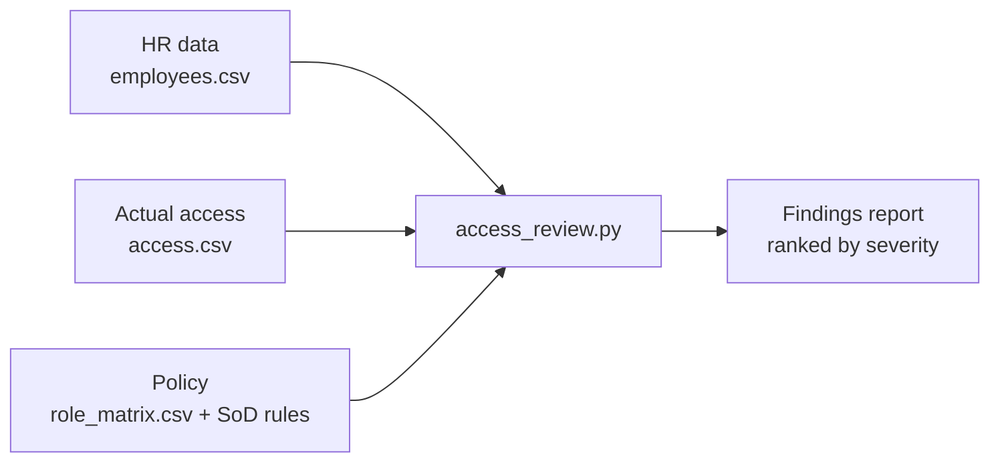
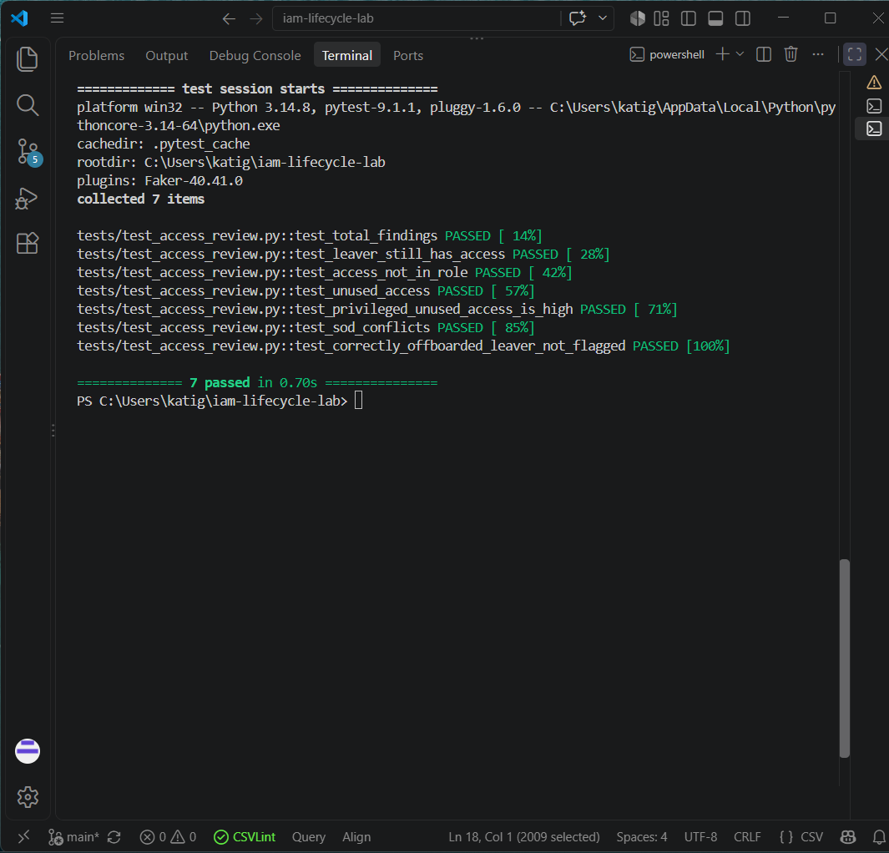

# Identity & Access Management Lifecycle Lab

A hands-on identity governance lab that models how a company controls who has access to what, from an employee's first day to their last.

It simulates a fictional 20-person company (**Nittany Analytics**), designs its access model, and uses **Python automation** to audit actual access against policy, flagging leavers who still have access, leftover access after role changes, separation-of-duties (SoD) conflicts, and unused access. The design is mapped to **SailPoint Identity Security Cloud (ISC)** concepts.

## What This Project Demonstrates

- **Identity lifecycle design:** Joiner, Mover, and Leaver (JML) processes covering how access is requested, approved, provisioned, reviewed, and revoked
- **Role-based access control (RBAC):** 6 roles mapped to entitlements across 8 systems
- **Least privilege and separation of duties:** 4 SoD rules based on real fraud scenarios, plus a privileged-access policy
- **Python automation:** an access review script that detects policy violations and ranks them by severity
- **Testing:** automated tests that verify every planted issue is caught *and* that correct cases aren't falsely flagged
- **Identity governance tooling:** concept mapping to SailPoint ISC

## How It Works



1. **`generate_data.py`** creates realistic sample HR and access data from the role matrix, with access problems planted on purpose.
2. **`access_review.py`** compares actual access against the HR source of truth and access policy, then runs four checks.
3. **`test_access_review.py`** verifies the results against a documented answer key.

## Results

The review found all **16 planted issues across 6 employees**, and correctly ignored an employee who was offboarded properly.

| Check | Lifecycle rule enforced | Findings | Severity |
|---|---|---|---|
| Leaver still has access | Leavers must have zero access | 7 | Critical |
| Access not in current role | Movers lose old-role access; no privilege creep | 4 | High / Medium |
| SoD conflict | No one holds conflicting duties | 3 | High |
| Unused access (90+ days) | Access should be used and reviewed | 2 | High (privileged) / Low |

**Example:** Priya Shah was promoted from AP Clerk to Finance Manager but kept her old access. She could create a vendor *and* approve payments to it, a classic fraud risk. The script flags both the leftover access and the two SoD conflicts it creates.



## Repository Structure

```
iam-lifecycle-lab/
├── design/
│   ├── org-model.md          # Roles, systems, entitlements, SoD rules, privileged access
│   └── lifecycle.md          # Joiner/Mover/Leaver processes with flowcharts
├── data/
│   ├── role_matrix.csv       # Role → entitlement policy
│   ├── employees.csv         # Generated HR source of truth
│   └── access.csv            # Generated actual access
├── src/
│   ├── generate_data.py      # Sample data generator with planted issues
│   └── access_review.py      # Access review automation
├── tests/
│   └── test_access_review.py # Automated tests
├── output/
│   └── access_review_findings.csv
├── docs/
│   ├── expected-findings.md  # Answer key for planted issues
│   └── sailpoint-mapping.md  # Mapping to SailPoint ISC concepts
└── screenshots/
```

## Run It Yourself

Requires Python 3.10+.

```bash
git clone https://github.com/MadAffix/iam-lifecycle-lab.git
cd iam-lifecycle-lab
pip install -r requirements.txt

python src/generate_data.py     # generate sample data
python src/access_review.py     # run the access review
python -m pytest -v             # run the tests
```

The findings report is written to `output/access_review_findings.csv`.

## Key Design Decisions

- **HR is the source of truth.** Every lifecycle event starts from an HR change, never an ad-hoc request to IT.
- **Remove conflicting access before granting new access.** In the mover flow, old access that would create an SoD conflict is revoked first.
- **Severity reflects risk, not just rule type.** Unused `AWS:Admin` is High, while unused `AWS:Developer` is Low.
- **Test for false positives, not just hits.** A correctly offboarded leaver (E018) is included as a control case.
- **Detective controls complement preventive ones.** Tools like SailPoint prevent most issues automatically; access reviews catch what slips through, such as manual grants, failed deprovisioning, and forgotten exceptions. See [`docs/sailpoint-mapping.md`](docs/sailpoint-mapping.md).

## Skills & Tools

Python · pandas · pytest · Faker · Git/GitHub · Mermaid · Identity lifecycle management · RBAC · Separation of duties · Access certification · SailPoint ISC concepts

## Author

   Avinash Katigiri · [LinkedIn](https://www.linkedin.com/in/avinashkatigiri) · [GitHub](https://github.com/MadAffix)
